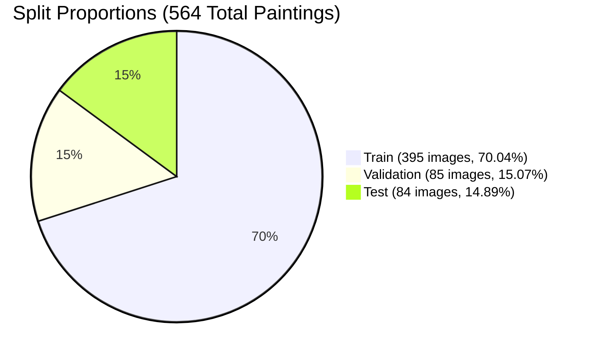

# Phase 1 & Phase 2 Completion Report: Mughal & Ragamala Paintings Dataset

This report documents the completion of **Phase 1** and **Phase 2** as specified in the project checklist.

---

## 1. Phase 1: Data Ingestion, Extraction & Metadata Parsing

### 1.1 Download and Stage Dataset
- **Local Directory Structure Staged:**
  - `data/raw/images`: Staged **564 images** (`.jpg`, `.jpeg`, `.png`).
  - `data/raw/captions`: Staged **564 individual `.txt` captions**.
  - `data/metadata`: Staged `metadata.jsonl`, `sources.txt`, and generated manifest files.
- **Verification Across the 3 Required Categories:**
  1. **Mughal Miniature Paintings**: 395 images (70.04%)
  2. **Painting Crops**: 134 images (23.76%) — detail studies of facial features, hands, ornaments, and boxed regions
  3. **Ragamala Paintings**: 35 full paintings (6.21%) — musical mode iconographies (plus 15 crop studies from the Benkaim Ragamala series)
  - **Total**: 564 images across all 3 categories.

---

### 1.2 Metadata Ingestion & Alignment
- **`sources.txt` Parsed**: Mapped 9 international museum institutions, auction houses, and archival collections:
  1. *Cleveland Museum of Art* (CMA Tuti-nama manuscript set)
  2. *National Museum of Asian Art* (Freer Gallery of Art & Arthur M. Sackler Gallery, including the Benkaim Ragamala collection)
  3. *Christie's* (Sale 17464, New York)
  4. *British Library & British Museum* (2006BL collection)
  5. *Metropolitan Museum of Art* (MMA)
  6. *Minneapolis Institute of Art* (Mia Ragamala slides)
  7. *Victoria and Albert Museum* (Hamzanama folios)
  8. *Open Art Images*
  9. *Walters Art Museum*
- **Alignment**:
  - Linked all 564 entries in [metadata.jsonl](file:///d:/NPTEL/data/metadata/metadata.jsonl) directly to corresponding image files on disk.
  - Validated individual `.txt` caption files against `metadata.jsonl` entries.
- **Tabular Manifest Generated**:
  - Exported to both [dataset_manifest.parquet](file:///d:/NPTEL/data/metadata/dataset_manifest.parquet) and [dataset_manifest.csv](file:///d:/NPTEL/data/metadata/dataset_manifest.csv).
  - Exact required schema:
    `image_id`, `file_path`, `category`, `raga`, `school`, `period`, `artist`, `collection_id`, `caption`, `has_box_labels`, `group_key`

---

### 1.3 Data Integrity & Validation
- **Image Header & Format Audit:**
  - Validated all 564 images using PIL header and bitstream verification.
  - **Corrupted / Unreadable Images**: **0** (100% pass rate).
  - **Color Channels**: All 564 images verified in standard **RGB mode**.
  - **Resolution Range**: Width from 71px to 9,378px (Mean: 1,703.8px); Height from 137px to 10,568px (Mean: 2,030.8px).
- **Target Label Distributions & Class Imbalance Analysis:**
  - **Category**: Class imbalance between full miniatures (395), crops (134), and Ragamala (35).
  - **School**: Mughal (516), Rajasthani (46), Provincial Mughal / Murshidabad (1), Pahari (1).
  - **Period**: Akbar Period (221), Classical Mughal (115), Late Mughal / 18th Century (32), Jahangir Period (21), Shah Jahan Period (17), Aurangzeb Period (14), 18th Century (3), 16th Century (1), Unknown/Unspecified (140).
  - **Artist**: 98.76% unattributed/unknown in court records; identifiable master hands include Ustad Mansur (5), Bishandas (1), and Dhanu (1).
  - **Raga Families**: Identified *Shri Raga*, *Kamod Raga*, *Saindhavi Ragini*, *Kakubha Ragini*, and general *Ragamala* series.
- Full audit results stored in [data_validation_report.json](file:///d:/NPTEL/data/metadata/data_validation_report.json).

---

## 2. Phase 2: Leak-Free Grouped Splitting Strategy

> [!IMPORTANT]
> Miniatures from the same manuscript set, series, or album share distinctive paletting, paper tone, border decoration, and artist hands. Random splitting causes data leakage and artificially inflated performance.

### 2.1 Identify Grouping Keys
Manuscript series, album accession sets, and collection provenance were parsed into **341 disjoint groups**:
- `ms_cma_tutinama`: 153 folios from the Cleveland Museum of Art *Tuti-nama* (c. 1560)
- `album_christies_nyr_17464`: 15 folios from Christie's Sale 17464
- `nmaa_fs_s2018_1`: 14 folios from the Freer-Sackler Benkaim Ragamala series
- `album_british_library_2006bl`: 12 folios from British Library 2006BL
- `nmaa_fs_f1907`: 6 folios from the Freer 1907 collection
- `ms_akbarnama`: 4 folios from the *Akbarnama*
- `ms_baburnama`: 3 folios from the *Baburnama*
- `nmaa_fs_8107`, `nmaa_fs_6786`, `nmaa_fs_8077`, `nmaa_fs_8184`, `nmaa_fs_8106`, `nmaa_fs_5814`, `nmaa_fs_6561`, `nmaa_fs_6878`, `nmaa_fs_7778`: distinct Freer-Sackler manuscript sets
- `ms_razmnama`, `ms_panj_ganj`, `ms_hamzanama`, `ms_zafarnama`, `ms_anvar_i_suhayli`: distinct imperial Mughal manuscripts
- `crop_mughal_*`: individual detailed studies
- `openart_*` / `indiv_*`: individual standalone folios

---

### 2.2 Grouped Stratified Partition
- **Target Partition**: 70% Train, 15% Validation, 15% Test.
- **Disjoint Groups Assertion**: **100% PASSED** (0 group overlap between Train, Val, and Test).

#### Split Breakdown Table:
| Metric / Target | Train Split | Validation Split | Test Split | Total |
| :--- | :--- | :--- | :--- | :--- |
| **Total Images** | **395 (70.04%)** | **85 (15.07%)** | **84 (14.89%)** | **564 (100%)** |
| **Unique Disjoint Groups** | **216 groups** | **60 groups** | **65 groups** | **341 groups** |
| **Mughal Miniature Paintings** | 276 | 60 | 59 | 395 |
| **Painting Crops** | 94 | 21 | 19 | 134 |
| **Ragamala Paintings** | 25 | 4 | 6 | 35 |
| **Mughal School** | 358 | 80 | 78 | 516 |
| **Rajasthani School** | 36 | 4 | 6 | 46 |
| **Pahari / Provincial Mughal** | 1 (Pahari) | 1 (Provincial Mughal) | 0 | 2 |